

  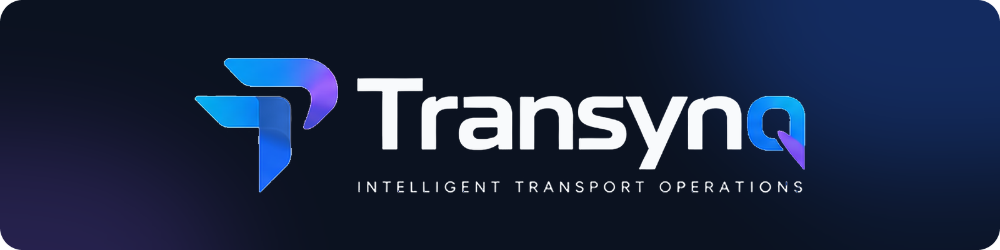

<h1 align="center">Transynq brand</h1>

<em>Smarter Transport. Connected Operations.</em>

Official logos, icons, colours, typography and imagery for [**Transynq**](https://transynq.io/), transport management software, and
[**Transynq TMS**](https://transynq.io/transport-management-system), the Transynq transport management system.
Use them to refer to Transynq: in integrations, articles, partner pages and presentations. Read the
[usage rules](#usage) and the [trademark notice](#trademark-notice) first.

## Logos

| Asset | Use on | File |
|---|---|---|
| 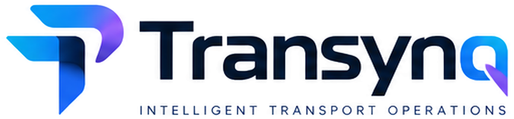 | light backgrounds | [`logos/transynq-logo-light.png`](logos/transynq-logo-light.png) |
|  | anywhere (own dark card) | [`logos/transynq-readme-banner.png`](logos/transynq-readme-banner.png) |
| white text, transparent | dark backgrounds | [`logos/transynq-logo-dark.png`](logos/transynq-logo-dark.png) |
| 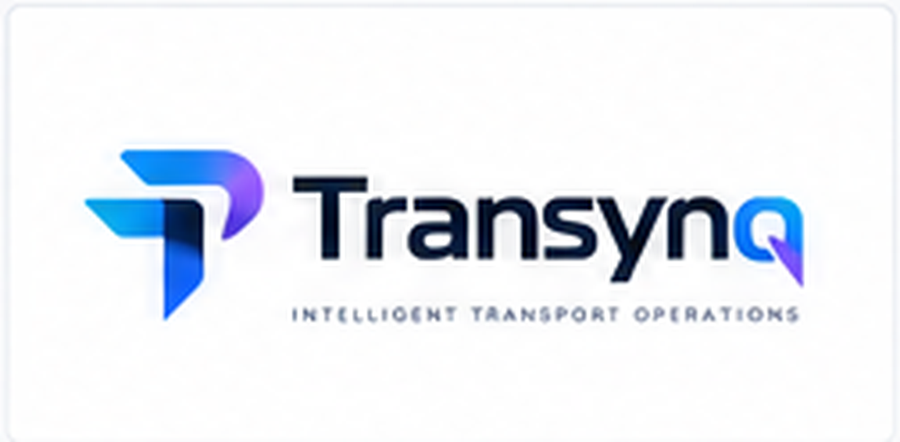 | horizontal lockup on light | [`logos/transynq-horizontal-on-light.png`](logos/transynq-horizontal-on-light.png) |
| 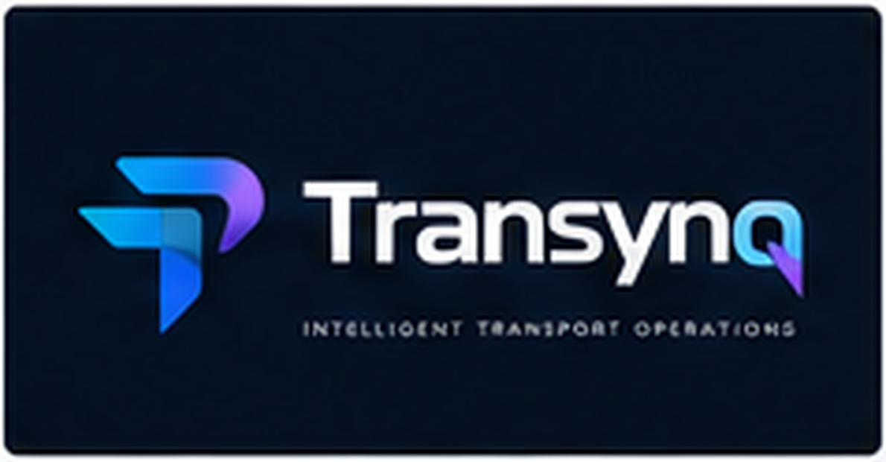 | horizontal lockup on dark | [`logos/transynq-horizontal-on-dark.png`](logos/transynq-horizontal-on-dark.png) |
| 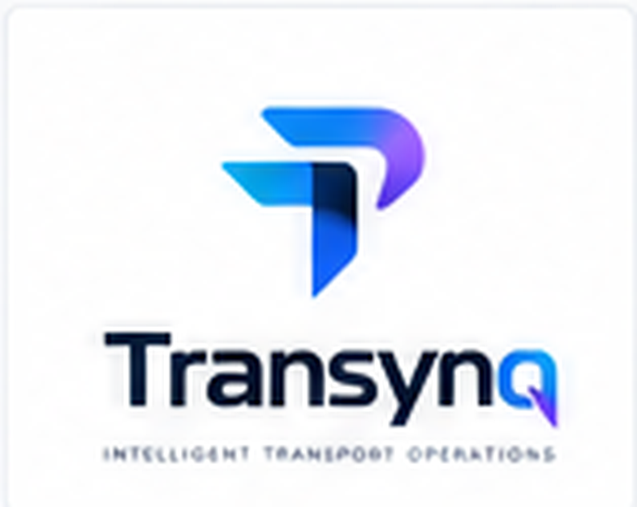 | square spaces | [`logos/transynq-stacked.png`](logos/transynq-stacked.png) |
| 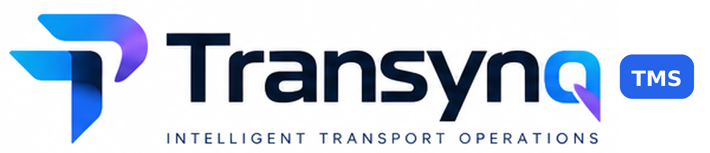 | product (Transynq TMS) | [`logos/transynq-tms-lockup-concept.png`](logos/transynq-tms-lockup-concept.png) |
| high-resolution wordmark | print, large formats | [`logos/transynq-primary-transparent.png`](logos/transynq-primary-transparent.png), [`logos/transynq-website-wordmark-transparent.png`](logos/transynq-website-wordmark-transparent.png) |

## Icons

  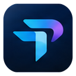
  
  
  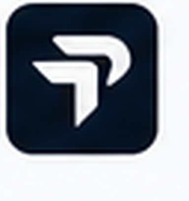

- [`icons/app/`](icons/app) - app icons for iOS, Android, Windows and web (16 px to 1024 px), plus dark, light and
  monochrome variants and the 1024 px master.
- [`icons/favicon/`](icons/favicon) - rounded tile with transparent corners (16 px to 512 px) and `favicon.ico`.

## Colours

| | Name | HEX | RGB |
|---|---|---|---|
|  | Primary | `#2563EB` | 37 99 235 |
|  | Secondary | `#06B6D4` | 6 182 212 |
|  | Accent | `#8B5CF6` | 139 92 246 |
|  | Success | `#10B981` | 16 185 129 |
|  | Warning | `#F59E0B` | 245 158 11 |
|  | Error | `#EF4444` | 239 68 68 |
|  | Near black | `#0B1220` | 11 18 32 |
|  | Dark grey | `#1F2937` | 31 41 55 |
|  | Grey | `#6B7280` | 107 114 128 |
|  | Light grey | `#E5E7EB` | 229 231 235 |
|  | Off-white | `#F8FAFC` | 248 250 252 |

Gradient: Primary → Secondary → Accent, used sparingly (brand bars, highlights). Dark surfaces use Near black.

## Typography

| Role | Typeface | Weights |
|---|---|---|
| Headings, UI | **Inter** | 400, 500, 600, 700 |
| Body, documents | **Plus Jakarta Sans** (or Inter) | 400, 500, 600 |
| Code, IDs, tracking numbers | **JetBrains Mono** | 400, 500, 700 |

All three are free under the SIL Open Font Licence (Google Fonts).

## Voice

- Tagline: **Intelligent Transport Operations**
- Headline: **Smarter Transport. Connected Operations.**
- Sign-off: **One Platform. Every Movement.**
- Tone: confident, precise, plain English. No hype, no jargon for its own sake.

## Imagery

| | |
|---|---|
| 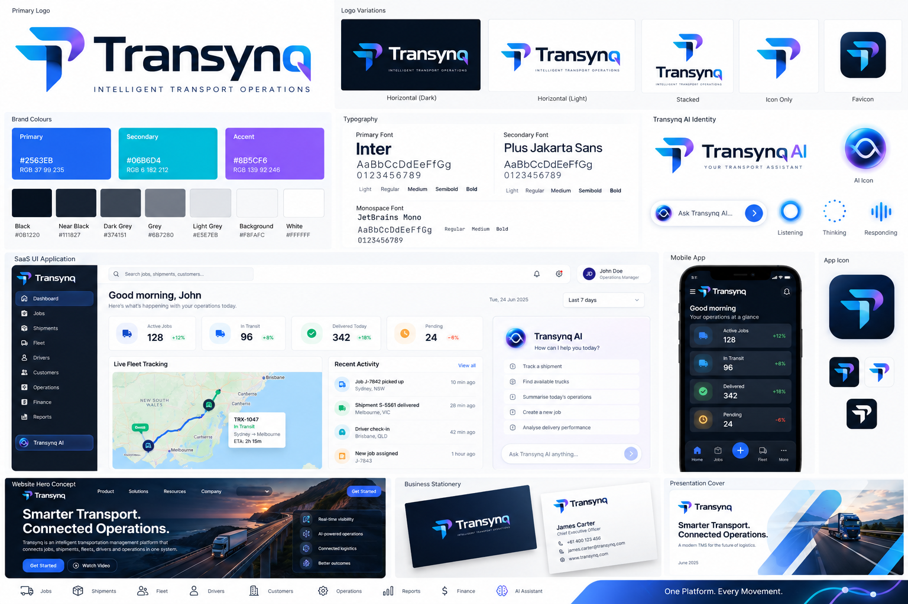 | [Brand identity moodboard](imagery/transynq-brand-moodboard.png): logo family, colours, typography, Transynq AI, UI, mobile |
|  | [Hero photography](imagery/transynq-highway-sunset.png): cold-chain truck on the highway at sunset |
| 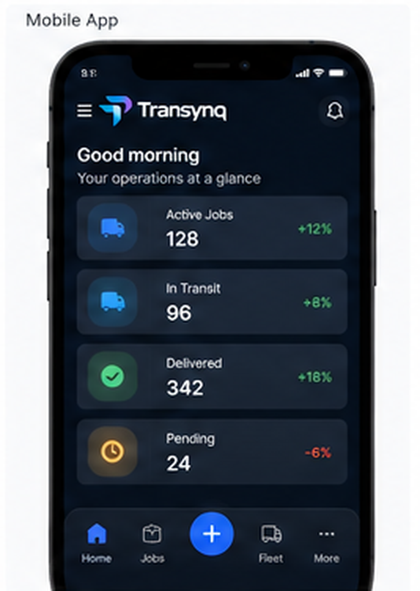 | [Mobile app](imagery/transynq-mobile-app-panel.png) and [device screen](imagery/transynq-mobile-app-device.png) |
| 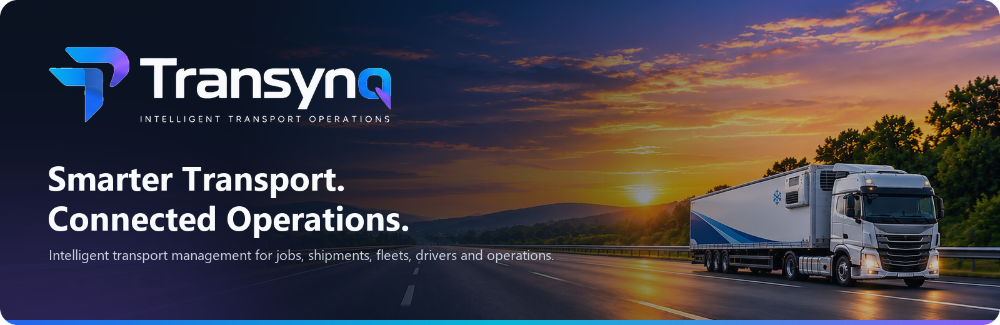 | [Social and banners](social): GitHub social preview (1280×640), organisation hero, footer strip |

## Usage

**Do**
- Use the files here as they are; pick the version made for your background.
- Keep clear space around the logo of at least the height of the "T" symbol's top bar.
- Keep the logo at least 24 px tall on screen (icon alone: 16 px).

**Don't**
- Stretch, rotate, recolour, outline or add effects (shadows, glows, 3D) to the logo.
- Put the dark-text logo on dark or busy backgrounds; use the white version or the dark card.
- Combine the logo with other marks, or use it to suggest Transynq endorses something it doesn't.

## Source files

These assets were exported from the brand kit as high-resolution PNGs. Vector masters (SVG, PDF, EPS) are not published
yet. [`tools/`](tools) holds the scripts that produced the web-sized logos, banners and icons from the kit.

## Trademark notice

The Transynq name, logos and app icons are trademarks of Transynq. They are **not** covered by the MIT licence of
Transynq's open-source code. You may use them only to refer to Transynq and its products, following the usage rules above.
For anything else, contact **contact@transynq.io**.
